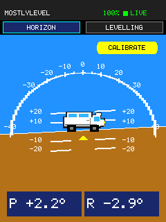
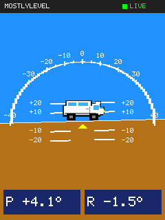
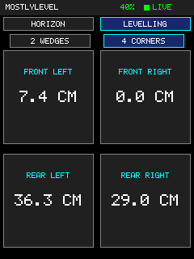
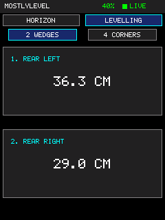

# MostlyLevel

MostlyLevel is a campervan levelling system prototype. The MicroPython app shows the van's pitch and roll on an ILI9341 display as two tilting views of the van: from behind, tilting with roll, and from the right, tilting with pitch, each on fixed level ground, using notifications from a WT901BLE67-like sensor. The BLE decoder also provides yaw, but the display does not use it.

## Screenshots

### ATTITUDE



The main screen, **ATTITUDE**, has two views, chosen with the tabs at its top. **VAN** (the default) shows the van from behind, tilting with roll, and from the right, tilting with pitch; each pivots on its lower wheel, and the edge of its ground turns green while that axis is level. The tilt is drawn three times the measured angle (`VAN_TILT_GAIN`, up to `VAN_TILT_MAX_DEG`) so small slopes are visible. **HORIZON** is the virtual horizon: moving sky and ground, pitch ladder, and curved scale, with the van seen from behind as the fixed symbol. Both show the true pitch and roll readouts and the sensor connection and battery status. (The screenshots show an earlier version of the HORIZON view, with a side-view van and the buttons one row higher.)



The green frame appears when both pitch and roll are within ±0.5°.

### LEVELLING — 4 CORNERS



This view shows the estimated lift height at each wheel corner.

### LEVELLING — 2 WEDGES



This view ranks the two corners with the largest estimated lift amounts for a two-wedge setup.

## Current status

- `src/app.py` provides two touch-selectable pages: **ATTITUDE** (sub-pages **VAN** and **HORIZON**) and **LEVELLING** for the corner lift estimates. The levelling page has **2 WEDGES** and **4 CORNERS** views; the two-wedge view is selected by default. The top bar shows the latest sensor battery percentage beside the BLE status.
- The display uses decoded pitch and roll from the WT901 BLE client and redraws the readouts and vans when either changes by at least 0.2°. The status header redraws at startup or when connection or battery status changes. Yaw is not displayed.
- On every page and view, a green frame around the whole screen (header and menu included) turns on when live pitch and roll are both within ±0.5° and stays on until either exceeds ±0.7°. These thresholds are configurable in `src/config.py`; the behavior has not yet been verified on hardware.
- If the sensor is stale or disconnected, the app displays a prominent warning and red frame instead of leaving a green level indication.
- Dashboard operation and BLE connection/notification behavior remain unverified. An initial LCD memory-read screenshot attempt returned all-zero pixels; the replacement software-rendered screenshot path has not yet been tested on hardware. Protocol assumptions, physical board variant, and installed firmware also remain unverified.

The **2 WEDGES** view ranks wheel corners by estimated lift and shows the two largest amounts. The **4 CORNERS** view shows all four estimates. Both use the owner-provided 4,035 mm wheelbase and 1,810/1,790 mm front/rear track widths with live vehicle pitch and roll. The calculation assumes the sensor is mounted level with the chassis at the midpoint of the wheelbase and track, positive pitch means front-high, and positive roll means left-high. These are geometric estimates; after placing wedges, recheck the live readings and adjust as needed. The pitch and roll signs were confirmed on the installed van (2026-10-16); the accuracy of the lift amounts has not been measured.

### Language

On the **ATTITUDE** screen (either view), press and hold (about 1 s) the cyan language button at the left, below the VAN/HORIZON tabs and on the same line as **CALIBRATE** (it shows **EN**, **DE**, **FR**, or **ES**), to switch to the next language; the screen redraws at once and the choice is saved in `/language.cfg` on the ESP32, so it survives restarts. Numbers use a decimal comma in French and Spanish and a decimal point in English and German (the owner's Swiss convention); the separator is the `decimal` entry in each language file.

The screen texts live in `src/lang_en.json`, `src/lang_de.json`, `src/lang_fr.json`, and `src/lang_es.json`, one key per text, written in uppercase (MicroPython only upper-cases ASCII letters). To change a text, edit the JSON file and deploy. To add a language, copy `lang_en.json` to `lang_<code>.json`, translate it, and add the code to `LANGUAGES` in `src/config.py`. The tests check that every file has every key, that every text fits its space on screen, and that the font has every character; a missing accented letter can be added to `ACCENTED` in `src/graphics.py`. The German, French, and Spanish texts were drafted by Claude and have not been reviewed by native speakers.

### Set the level reference

On the **ATTITUDE** screen (either view), after leveling the van with a trusted reference, press and hold the rounded yellow **CALIBRATE** button in the upper-right corner above the arc for about one second, until the bar along the button fills. A short tap does nothing, so a stray touch cannot overwrite the reference. The app records the current pitch and roll as zero offsets in `/level_reference.cfg` on the ESP32 and uses them after restart. Hold **CALIBRATE** again to replace the reference after changing the sensor mount. The button requires live sensor data. Confirm the result on the physical display before relying on it; this calibration flow has not yet been hardware-verified.

## Repository layout

- `src/main.py` — startup entry point; imports `app` and calls `app.run()`.
- `src/app.py` — dashboard, render loop (`setup()`, `step()`, `run()`).
- `src/ili9341.py` — direct SPI display driver.
- `src/graphics.py` — drawing helpers and bitmap font, including accented capitals.
- `src/i18n.py` — loads the screen texts of the selected language.
- `src/vans.py` — draws the vans: tilted on the VAN view and as the fixed symbol on the HORIZON view; `src/van_shapes.py` holds their shapes, generated by `tools/make_vans.py` (edit the shapes there and rerun it).
- `src/lang_*.json` — screen texts per language (English, German, French, Spanish).
- `src/compositor.py` — off-screen strip compositing used for flicker-free page redraws.
- `src/screenshot.py` — temporary framebuffer adapter and BMP writer used for screenshots.
- `src/ble_read.py` — BLE client and packet decoder used by the dashboard; it can also run as a serial diagnostic.
- `src/config.py` — editable sensor, vehicle geometry, display, touch, and timing settings.
- `src/touch.py` — minimal FT5x06 I2C touchscreen reader for the reference board wiring.
- `src/ble_scan.py` — standalone BLE discovery diagnostic; not used by the application.
- `tests/` — desktop tests with fake hardware modules and reference images.
- `tools/` — deploy, screenshot, and test scripts.
- `firmware/` — ESP32_GENERIC_S3 MicroPython firmware image.
- `reference/esp32_s3_es3c28p/` — separate ESP-IDF board support reference; it is not integrated with the MicroPython application.

## Setup and running

The repository does not include a dependency manifest or hardware test procedure. The firmware image's presence does not establish that it is installed on a device. Confirm the target board, MicroPython version, and wiring before running the application.

The application entry point is `src/main.py`, which starts the dashboard in `src/app.py`. The dashboard starts the BLE client in `src/ble_read.py`; `src/ble_scan.py` is an optional standalone diagnostic. The configured address, CCCD handle, UUID, and packet format assumptions have not been validated in checked-in hardware test records.

### Uploading and running on an ESP32

These instructions deploy the MicroPython application files to the board's filesystem. They assume the ESP32 already has a compatible MicroPython firmware installed; the firmware image in this repository has not been verified on a physical board.

From the repository root, install `mpremote` in the project's virtual environment if needed:

```bash
.venv/bin/python -m pip install mpremote
```

Connect the ESP32 over USB and check that it is detected:

```bash
.venv/bin/mpremote connect list
```

Upload the application and reset the board with the deploy script:

```bash
tools/deploy.sh
```

The script first builds `build/mpy/` with `tools/build_mpy.sh`: every module is precompiled to `.mpy` with `mpy-cross`, except `main.py` (MicroPython only starts `main.py` from source) and `config.py` (kept readable and editable), and `ble_scan.py` is left out. Precompiled modules start faster (about 0.2 s instead of 0.7 s to import the app, measured on the board) and spare the board compiling `app.py`; steady-state free memory is about the same either way (see `docs/decisions.md`). In one `mpremote` session the script then checks that the board accepts the `.mpy` version, copies the bundle to the filesystem root, deletes stale `.py` copies of precompiled modules (MicroPython would load `app.py` before `app.mpy`), and resets the board. `mpremote` compares each file's SHA-256 hash with the copy on the board and skips unchanged files, so you can run the script after any edit. It needs the dev tools from `requirements-dev.txt` (see "Tests and CI"); `mpy-cross` 1.29 matches the board's MicroPython 1.29.

Options: `-s` uploads the `.py` sources instead of `.mpy` (and removes stale `.mpy` files), `-p PORT` selects a serial port instead of `auto`, `-f` copies files even if unchanged, `-n` skips the reset, `-r` opens the REPL instead of resetting, and file arguments (for example `tools/deploy.sh src/ble_scan.py`) upload only those files as they are. The script never touches `boot.py`, the level reference, or other files on the board.

To copy source files one at a time instead:

```bash
.venv/bin/mpremote connect auto fs cp src/config.py :config.py
.venv/bin/mpremote connect auto fs cp src/main.py :main.py
.venv/bin/mpremote connect auto fs cp src/app.py :app.py
.venv/bin/mpremote connect auto fs cp src/ili9341.py :ili9341.py
.venv/bin/mpremote connect auto fs cp src/graphics.py :graphics.py
.venv/bin/mpremote connect auto fs cp src/compositor.py :compositor.py
.venv/bin/mpremote connect auto fs cp src/ble_read.py :ble_read.py
.venv/bin/mpremote connect auto fs cp src/touch.py :touch.py
.venv/bin/mpremote connect auto fs cp src/screenshot.py :screenshot.py
```

The files belong in the root because `main.py` and `app.py` import the modules by name. `ble_scan.py` is a separate discovery diagnostic and is not needed to run the dashboard.

### Configuration

Edit `src/config.py` for the sensor MAC address, GATT UUIDs and notification handle, packet scaling and battery percentage bands, sensor-to-vehicle axis mapping and signs, van geometry, display timing, and LCD/touch pin assignments. The MAC is written as 12 hexadecimal digits without colons. Keep the ESP32's `config.py` in sync when uploading changes. Some values, including the CCCD handle and sensor axis/sign assumptions, remain unverified and should only be changed based on hardware checks.

After copying, power-cycle the board. MicroPython runs the board's `main.py` at startup. To open the serial REPL and inspect output or errors, run:

```bash
.venv/bin/mpremote connect auto repl
```

If automatic connection does not find the board, use the serial port shown by `connect list` in place of `auto`. These deployment steps have not been tested against the project's physical ESP32/display/sensor setup.

### Sensor battery display and diagnostic

The dashboard requests the sensor power register after BLE becomes live and then once per minute. It shows the latest percentage beside the `LIVE` status; until the first reply, the percentage area stays blank. The conversion uses the voltage-to-percentage bands published for a related WT9011DCL-BT50 model. On the connected unit, raw value `385` decoded to `3.85 V`, matching the Android app's 60% reading. The percentage conversion still needs comparison at other battery levels on this exact sensor.

To use the dashboard battery display, deploy the app with `tools/deploy.sh`. To inspect the reading manually, let the dashboard connect to the sensor, then open the REPL and interrupt the app with Ctrl+C:

```bash
.venv/bin/mpremote connect auto repl
```

At the MicroPython prompt, request the value and check the response:

```python
app.sensor.request_power_read()
import time
time.sleep_ms(1000)
print(app.sensor.last_power_response)
print(app.sensor.power_raw, app.sensor.power_voltage, app.sensor.power_percent)
```

The connected unit returned a `55 71` register response, with `power_raw` equal to `385`, `power_voltage` equal to `3.85`, and `power_percent` equal to `60`. If these values remain `None` on another attempt, the expected power-register response was not received during that attempt.

### Capturing a display screenshot

The app can render the last displayed attitude into small temporary RGB565 strips and save it as `/screenshot.bmp` on the ESP32. It renders in 8-row strips to avoid allocating a full-screen buffer. This reproduces the app's last rendered UI state; it does not read pixels back from the LCD controller. Upload `screenshot.py` as shown above before using this feature.

With the app running on the board, capture the current screen as a PNG in `assets/`:

```bash
tools/screenshot.sh                # assets/screenshot.png
tools/screenshot.sh levelling      # assets/levelling.png
```

The script interrupts the app, calls `save_screenshot()` on the board, copies the BMP to a temporary folder and deletes it from the board, converts it to PNG with ImageMagick (`magick`), and resets the board so the app starts again. The PNG is named after the given name without its extension, so `corners.bmp` and `wedges.png` give `assets/corners.png` and `assets/wedges.png`; on the board, a name without `.bmp` gets `.bmp` appended. Options: `-p PORT` selects a serial port instead of `auto`, and `-n` leaves the app stopped. It uses `mpremote resume` so the board is not soft-reset before the capture, which would clear the screen state being captured.

To capture manually instead, open the device REPL and interrupt the running application with Ctrl+C. Then call:

```python
save_screenshot("/screenshot.bmp")
```

Exit the REPL and copy the image into the screenshots directory:

```bash
mkdir -p screenshots
.venv/bin/mpremote connect auto fs cp :screenshot.bmp ./screenshots/screenshot1.bmp
```

You can then open `screenshots/screenshot1.bmp` or convert it to PNG for display in Markdown. The device needs enough free RAM for a small strip buffer and enough filesystem space for the BMP.

## Tests and CI

The tests run the MicroPython sources under desktop Python with stand-ins for the firmware modules (`machine`, `bluetooth`, `framebuf`) in `tests/fakes/`. The fake LCD decodes the ILI9341 command stream into pixels, so rendering is checked exactly as the driver would draw it. They cover packet decoding, the BLE client handshake, levelling maths, axis mapping and calibration, touch targets, the display driver and compositor, rendering invariants, and reference images of each page in `tests/golden/`. They do not exercise the real board, sensor, or touchscreen.

Install the tools once, then run everything CI runs (ruff, a MicroPython compile check with `mpy-cross`, and pytest):

```bash
.venv/bin/python -m pip install -r requirements-dev.txt
tools/test.sh
```

After an intentional visual change, regenerate the reference images and review them in the diff before committing:

```bash
tools/test.sh --update-golden
```

When a reference image differs, the test writes the actual image to `tests/golden/_actual/`; in CI it is attached to the run as the `golden-actual` artifact. GitHub Actions (`.github/workflows/ci.yml`) runs `tools/test.sh` for every pull request into `main` and after each merge, then builds the `.mpy` bundle and attaches it to the run as the `mostlylevel-mpy-<commit>` artifact; its files can be copied to the board as they are.

## License

MostlyLevel's own code is licensed under the [MIT License](LICENSE). The ILI9341 initialisation values and the bitmap font come from Adafruit's BSD-licensed libraries, the firmware image is MicroPython (MIT, with bundled components under their own licenses), and `reference/` is Espressif's Apache-2.0 board-support code. See [THIRD_PARTY_NOTICES.md](THIRD_PARTY_NOTICES.md) for details and the required notices.

## Documentation

- [Project context](PROJECT_CONTEXT.md) — current project snapshot and status vocabulary.
- [Architecture](docs/architecture.md) — display and BLE code paths and reference BSP boundary.
- [Hardware](docs/hardware.md) — source-configured pin map and unresolved hardware details.
- [Decisions and open questions](docs/decisions.md) — implementation choices, assumptions, and questions to resolve.
- [Changelog](CHANGELOG.md) — notable changes.

See [AGENTS.md](AGENTS.md) for guidance intended for future development sessions.
