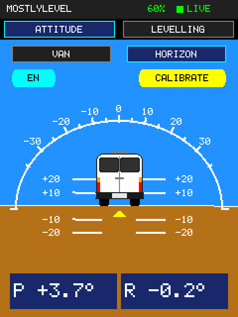
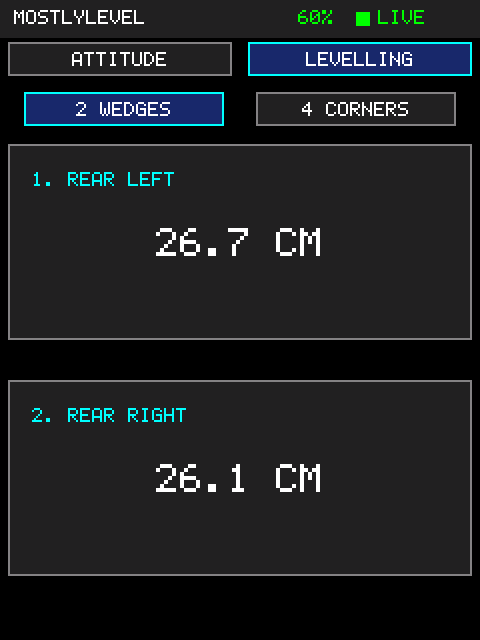
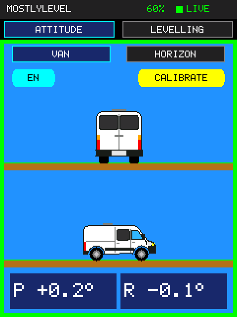
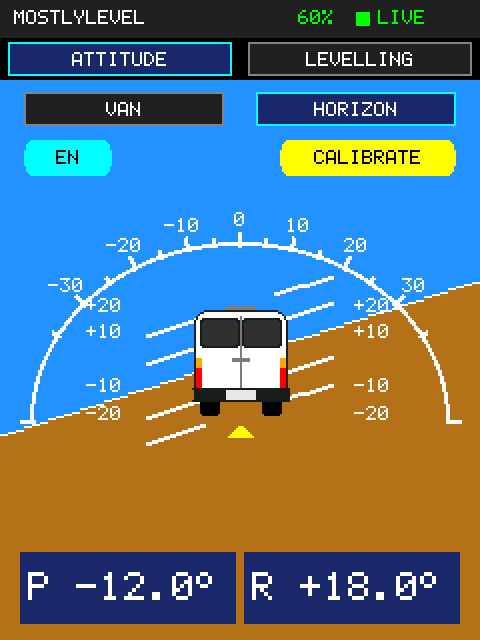
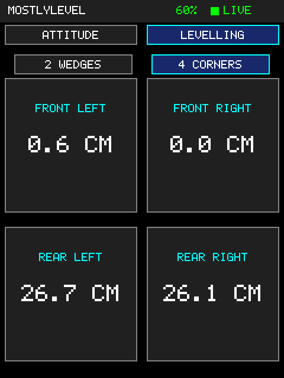
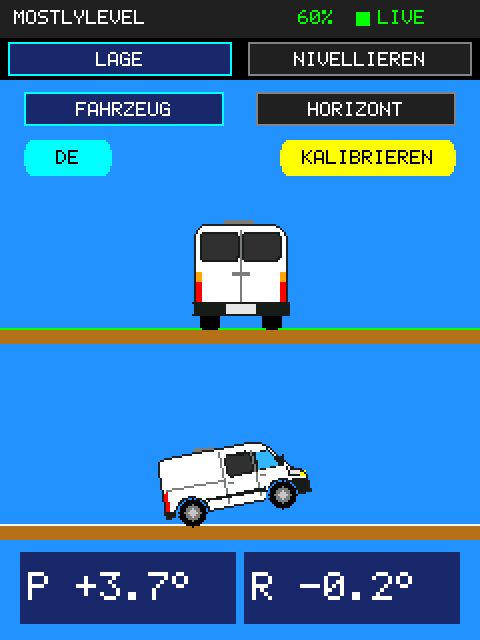
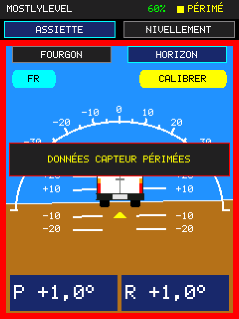

# MostlyLevel

[](https://github.com/kwyjibo089/MostlyLevel/actions/workflows/esp32.yml)
[](LICENSE)

**A touchscreen levelling display for campervans.** A small ESP32-S3 display reads a Bluetooth tilt sensor mounted in the van and shows, live, how the van is tilted and how much to lift each wheel to get it level.

<p>
  
  
  
  
</p>

*Screens as drawn by the app (240 × 320 px, shown at 2×). The images are rendered from the app's own drawing code by the desktop tests; a screenshot taken on the device matched them.*

> **Status: working prototype.** It runs in the owner's van (a Fiat Ducato-style campervan) and is used day to day. Several things are still assumptions; see [What is verified](#what-is-verified). This README is also the project's state summary for other tools and assistants (for example, enclosure design in Claude Desktop with Fusion): it describes the code as it is on `main`.

## Contents

- [Features](#features)
- [Hardware](#hardware)
- [How it works](#how-it-works)
- [Getting started](#getting-started)
- [Using MostlyLevel](#using-mostlylevel)
- [Configuration](#configuration)
- [Development](#development)
- [What is verified](#what-is-verified)
- [Enclosure design notes](#enclosure-design-notes)
- [Towards a product](#towards-a-product)
- [Repository layout](#repository-layout)
- [License](#license)

## Features

- **Two ways to read the van's attitude** on the ATTITUDE page:
  - **VAN**: the van seen from behind tilts with roll, and seen from the right it tilts with pitch. Each stands on level ground and pivots on its lower wheel; the tilt is drawn 3× exaggerated so small slopes are visible.
  - **HORIZON**: an aircraft-style attitude indicator (moving sky and ground, pitch ladder, curved scale) with the van seen from behind as the fixed symbol.
- **Wedge advice** on the LEVELLING page: **2 WEDGES** names the two wheels to lift and by how many centimetres; **4 CORNERS** shows all four. Computed from the van's wheelbase and track widths.
- **Level indicator**: a green frame around the whole screen while pitch and roll are both within ±0.5° (with hysteresis, so it does not flicker at the edge).
- **Calibration**: hold **CALIBRATE** for one second to make the current attitude the level reference; it survives restarts.
- **Four languages**: English, German, French, Spanish, switchable on the device (hold the language button); the choice survives restarts.
- **Sensor status**: live, stale, or disconnected state and the sensor's battery level in the header, with clear warnings when data is missing.
- **Robust for long runs**: automatic Bluetooth reconnection and recovery, and the app restarts the board after repeated errors instead of freezing with a stale "level" picture.
- **Flicker-free drawing**: pages are composited off-screen in strips and sent to the display in one transfer per strip.

### Android app

An Android app in [`mobile/`](mobile/README.md) does the same job on a phone: it connects directly to the sensor and shows the same pages, with phone-sized graphics, a choice of camper type and colour, and settings for the sensor, the dimensions, and the language. It is a first version; its levelling maths and sensor decoding are tested against the ESP32 code. The sensor accepts one connection at a time, so the phone and the display cannot both be connected.

## Hardware

| Part | What is used | Notes |
| --- | --- | --- |
| Display board | ESP32-S3 2.8" display board, ES3C28P family | 240 × 320 ILI9341 IPS display on SPI, capacitive touch on I2C. Vendor documentation: [lcdwiki 2.8inch ESP32-S3 Display](https://www.lcdwiki.com/2.8inch_ESP32-S3_Display). |
| Firmware | MicroPython 1.29.0, `ESP32_GENERIC_S3` | The image in `esp32/firmware/` is byte-identical to the official download. |
| Tilt sensor | WT901BLE67-style BLE inclinometer | Sends attitude notifications over Bluetooth LE; battery powered. Configured by its BLE address in `esp32/src/config.py`. |
| Power | USB-C, 5 V | The board also has a Li-Po connector with charger (not used by the app). |

**Pin assignments** (from the vendor's board-support package, matching the app):

| Signal | GPIO |
| --- | --- |
| LCD SPI SCK / MOSI / MISO | 12 / 11 / 13 |
| LCD CS / DC / backlight | 10 / 46 / 45 |
| Touch I2C SCL / SDA, reset | 15 / 16, 18 (address `0x38`) |

The vendor documentation lists the touch controller as an FT6336G; the app talks to it with a minimal FT5x06-compatible reader. More detail, including what is unconfirmed, is in [docs/hardware.md](docs/hardware.md).

## How it works

```
WT901 sensor ──BLE notify──▶ ble_read.py ──latest sample──▶ app.py step()  (every ~30 ms)
                               ▲     │                               ├─ vehicle pitch/roll (axis mapping, calibration)
                               └─────┘ reconnect / recover           ├─ ATTITUDE: vans.py (VAN) or the horizon (HORIZON)
FT5x06 touch ──I2C──▶ touch.py ──taps, long presses────────────────▶ ├─ LEVELLING: corner lift estimates
                                                                     └─ compositor.py ──strips──▶ ili9341.py ──SPI──▶ LCD
```

- `main.py` imports `app.py` and calls `app.run()`: `setup()` once, then `step()` in a loop. BLE callbacks only store the latest sample; all drawing happens in `step()`.
- Pages are recorded as filled rectangles (plus small bitmaps for pictures such as the vans and the arc), composited into a 240 × 40 strip buffer, and sent strip by strip. Strips whose content did not change are skipped.
- The vans are vector shapes generated on the desktop (`esp32/tools/make_vans.py` → `esp32/src/van_shapes.py`) and rotated on the board with integer maths, then filled with `framebuf.poly()`.
- Screen texts come from `shared/i18n/lang_<code>.json`; only the active language is kept in memory.

More: [docs/architecture.md](docs/architecture.md) and the decision log in [docs/decisions.md](docs/decisions.md).

## Getting started

You need the display board, a WT901BLE67-style sensor, a USB-C cable, and Python 3 on your computer.

1. **Install the tools** (in the `esp32/` folder; all commands below run from there):

   ```bash
   cd esp32
   python3 -m venv .venv
   .venv/bin/python -m pip install -r requirements-dev.txt
   ```

2. **Flash MicroPython** if the board does not have it yet. This is MicroPython's standard procedure for ESP32-S3 boards; it has not been recorded for this board in the repository:

   ```bash
   .venv/bin/python -m pip install esptool
   .venv/bin/python -m esptool --chip esp32s3 erase_flash
   .venv/bin/python -m esptool --chip esp32s3 write_flash -z 0 firmware/ESP32_GENERIC_S3-20260824-v1.29.0.bin
   ```

3. **Point the app at your sensor**: set `SENSOR_MAC` in `src/config.py` to the sensor's BLE address (`src/ble_scan.py` lists nearby devices), and set your van's `WHEELBASE_MM`, `FRONT_TRACK_MM`, and `REAR_TRACK_MM`.

4. **Deploy and start**:

   ```bash
   tools/deploy.sh            # or: tools/deploy.sh -p /dev/ttyACM0
   ```

   This precompiles the app to `.mpy`, uploads only changed files, and resets the board. The display shows *WAITING FOR SENSOR* until the sensor connects.

5. **Mount and calibrate**: fix the sensor in the van, level the van with a trusted spirit level, and hold **CALIBRATE** for one second.

`esp32/tools/deploy.sh -h` lists the options (upload sources instead of `.mpy`, choose a port, open the REPL, and so on).

## Using MostlyLevel

| Page | Shows | Touch |
| --- | --- | --- |
| **ATTITUDE → VAN** | Rear view (roll) and side view (pitch) of the van, P/R readouts | Tabs switch views; hold **CALIBRATE** or the language button for 1 s |
| **ATTITUDE → HORIZON** | Virtual horizon, pitch ladder, curved scale, P/R readouts | Same as VAN |
| **LEVELLING → 2 WEDGES** | The two wheels to lift, with heights in cm, or *NO WEDGES NEEDED* | Tabs switch views |
| **LEVELLING → 4 CORNERS** | Lift for each wheel | Tabs switch views |

- **Signs**: positive pitch = front higher; positive roll = left side higher. Left and right are as seen facing forward.
- **HORIZON** follows the aircraft convention as seen from the driver's seat: with the left side high, the horizon rises on the right.
- **Lift heights** are geometric estimates (the van treated as a rigid plane, the sensor assumed at the centre of the wheel footprint). Recheck the readings after placing wedges.
- **Header**: the sensor's battery level and the connection state (LIVE, SCANNING, STALE, NO LINK, …).

<p>
  
  
  
  
</p>

## Configuration

All adjustable values live in [`esp32/src/config.py`](src/config.py), with comments saying which are tested and which are assumptions. The ones you are most likely to change:

| Setting | Default | Purpose |
| --- | --- | --- |
| `SENSOR_MAC` | the owner's sensor | BLE address of the sensor to connect to |
| `WHEELBASE_MM`, `FRONT_TRACK_MM`, `REAR_TRACK_MM` | 4035, 1810, 1790 | Van geometry for the lift estimates |
| `DISPLAY_PITCH_SIGN`, `DISPLAY_ROLL_SIGN` | 1.0 | Flip if the sensor is mounted the other way round |
| `LEVEL_FRAME_THRESHOLD_DEG`, `LEVEL_FRAME_RELEASE_THRESHOLD_DEG` | 0.5, 0.7 | When the green frame turns on and off |
| `VAN_TILT_GAIN`, `VAN_TILT_MAX_DEG` | 3.0, 20 | Exaggeration of the VAN view's tilt |
| `SCREEN_TOP_INSET` | 0 | Rows hidden by the case at the top of the display (the first case needed 10) |
| `LANGUAGES`, `DEFAULT_LANGUAGE` | en, de, fr, es; en | Languages offered by the language button |
| `LONG_PRESS_MS` | 1000 | Hold time for CALIBRATE and the language button |

Screen texts are in `shared/i18n/lang_en.json`, `lang_de.json`, `lang_fr.json`, and `lang_es.json` (shared with the planned Android app). To add a language, copy `lang_en.json` to `lang_<code>.json`, translate it (in uppercase), and add the code to `LANGUAGES`; the tests check that every text fits its space and that the font has every character.

## Development

Run these from the `esp32/` folder:

```bash
tools/test.sh                 # ruff, MicroPython compile check (mpy-cross), pytest
tools/test.sh --update-golden # after an intentional visual change; review the image diff
tools/screenshot.sh [name]    # capture the running display as ../assets/<name>.png
tools/make_vans.py            # regenerate src/van_shapes.py after editing the van shapes
tools/readme_images.sh        # refresh ../assets/ from tests/golden/
```

- **Tests** run the MicroPython sources under desktop Python with fake hardware (`esp32/tests/fakes/`: `machine`, `bluetooth`, `framebuf`, and an ILI9341 panel model that decodes the SPI commands into pixels). They cover the BLE client and decoder, levelling maths, touch, rendering invariants (composited output equals direct drawing), recovery logic, and reference images of every page and language in `esp32/tests/golden/`. Passing tests show behaviour against the fakes, not on hardware.
- **CI** (GitHub Actions, `.github/workflows/esp32.yml`) runs `esp32/tools/test.sh` for every pull request and push to `main`, then builds the `.mpy` bundle as a downloadable artifact. `main` is protected: changes go through pull requests.
- **Records**: [CHANGELOG.md](CHANGELOG.md) for changes, [docs/decisions.md](docs/decisions.md) for design decisions with their measurements.

## What is verified

| Area | State |
| --- | --- |
| Display output at 40 MHz SPI, flicker-free redraws | Confirmed by the owner on the device |
| Touch navigation, tabs, long press, language switching | Used by the owner on the device |
| BLE connection, notifications, automatic reconnect | Seen on the device; the disconnect warning was checked by switching the sensor off and on |
| Pitch/roll signs and axis mapping | Confirmed on the installed van (front up = +pitch, left up = +roll) |
| LEVELLING picks the correct wheels | Confirmed by the owner; the **accuracy** of the lift heights is not yet measured |
| Battery percentage | One data point (3.85 V = 60 %); other levels unchecked |
| Stability | Stress runs of 2–6 minutes with constant movement: no errors, steady memory (~54–76 KB free). A multi-hour run is planned |
| Calibration saved across restarts | Implemented and tested on the desktop; not yet checked on the device |
| Translations | Drafted by an AI assistant; not yet reviewed by native speakers |

## Enclosure design notes

Facts relevant to designing a case. They come from the vendor documentation unless marked otherwise; **measure the actual board before finalising a design**.

- **Board size**: 50.0 × 86.0 mm, 10.6 mm thick with the touch panel (9.1 mm without). Weight about 111 g. Four mounting holes, one in each corner.
- **Display**: 2.8" IPS, 240 × 320 px, used in **portrait** orientation with the USB-C port at the **bottom** edge.
- **Visible area**: the UI uses the display edge to edge, so the whole display area should stay visible and touchable. The first printed case hid about the top 9 pixel rows (`SCREEN_TOP_INSET` was 10); the redesigned case (2026-10-18) leaves the whole display visible, so the inset is 0. A case that covers part of the display again needs `SCREEN_TOP_INSET` set to the hidden rows.
- **Touch**: capacitive; the cover must not press on the glass, and conductive material over the panel affects touch.
- **Radio**: the ESP32-S3 talks to the sensor over Bluetooth; the vendor drawing shows an antenna area at the top edge of the board, so avoid metal there.
- **Ports and power**: USB-C (5 V) at the bottom. Typical consumption about 140 mA with the display on.
- **Sensor**: a separate battery-powered unit, mounted level and fixed in the van, within Bluetooth range of the display.

## Towards a product

Things to settle before selling MostlyLevel devices (a technical checklist, not legal advice):

- **Per-device setup**: the sensor's BLE address, van geometry, and sensor orientation are currently set in `esp32/src/config.py`. Customers need an on-device setup flow: pairing by scanning for the sensor, entering the wheelbase and track widths, and choosing the mounting direction.
- **Measured accuracy**: check the lift estimates against real wedge heights, and the battery bands at more levels.
- **Long-run test**: an overnight run with the real sensor.
- **Licences and notices**: the device firmware contains MicroPython (MIT), components under Apache-2.0, and Adafruit-derived code under BSD. Their notices must ship with each device, for example in the printed manual or on the product page; see [THIRD_PARTY_NOTICES.md](THIRD_PARTY_NOTICES.md).
- **Branding**: the van drawing is styled after a Fiat Ducato but carries no logo. Using "Fiat" or "Ducato" in product names or marketing touches their trademarks.
- **Compliance**: electronics sold in the EU, UK, Switzerland, or US generally need conformity marking (CE, UKCA, FCC) and safety documentation for the complete product, even when the radio module is already certified.

## Repository layout

| Path | Contents |
| --- | --- |
| `esp32/src/main.py`, `esp32/src/app.py` | Entry point; the app: pages, touch handling, main loop |
| `esp32/src/ble_read.py` | BLE client, packet decoder, reconnection and recovery |
| `esp32/src/vans.py`, `esp32/src/van_shapes.py` | Tilted van drawing; generated van shapes |
| `esp32/src/compositor.py` | Off-screen strip compositing and bitmaps |
| `esp32/src/graphics.py`, `esp32/src/ili9341.py`, `esp32/src/touch.py` | Drawing helpers and font, display driver, touch reader |
| `esp32/src/i18n.py` | Language loading |
| `esp32/src/config.py` | All settings |
| `esp32/src/screenshot.py`, `esp32/src/ble_scan.py` | Screenshot writer; standalone BLE scan diagnostic |
| `esp32/tests/` | Desktop tests, fake hardware, reference images |
| `esp32/tools/` | Deploy, build, test, screenshot, van-shape, and README-image scripts |
| `esp32/firmware/` | The MicroPython firmware image and its licence |
| `esp32/reference/esp32_s3_es3c28p/` | The vendor's ESP-IDF board-support package, kept as reference only (not used by the app) |
| `esp32/pyproject.toml`, `esp32/requirements-dev.txt` | Desktop tooling: pytest, ruff, mpy-cross |
| `esp32/tools/make_fixtures.py` | Writes `shared/fixtures/`: the ESP32 logic's results that the Android app is tested against |
| `shared/i18n/lang_*.json` | The ESP32's screen texts (all caps for its font) |
| `shared/fixtures/` | Reference results of the ESP32 decoder and levelling maths, generated; see `mobile/README.md` |
| `mobile/` | The Android app (React Native, Expo) with the same functionality as the display; see [mobile/README.md](mobile/README.md) |
| `hardware/` | KiCad project for the custom PCB: schematic, layout, footprints, BOM, fabrication files, vendor data |
| `case/` | Enclosure design files (empty so far) |
| `docs/` | Architecture, hardware, and decision records |
| `assets/` | README images and screenshots |

## License

MostlyLevel's own code is licensed under the [MIT License](LICENSE). The ILI9341 initialisation values and the bitmap font come from Adafruit's BSD-licensed libraries, the firmware image is MicroPython (MIT, with bundled components under their own licences), and `esp32/reference/` is Espressif's Apache-2.0 board-support code. Details and the required notices are in [THIRD_PARTY_NOTICES.md](THIRD_PARTY_NOTICES.md).
